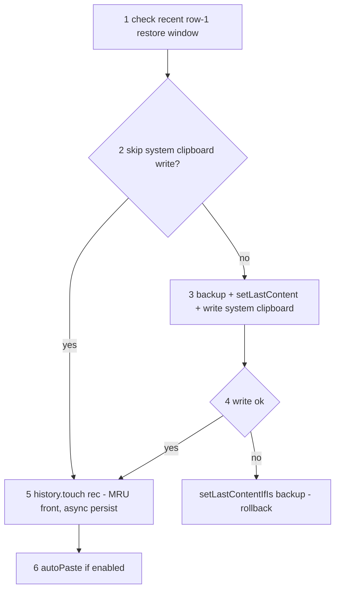
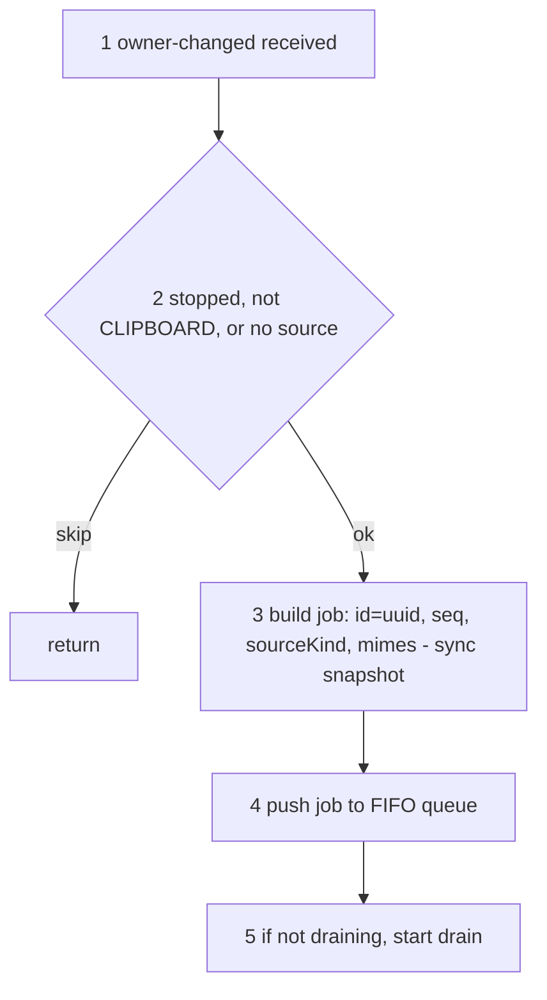
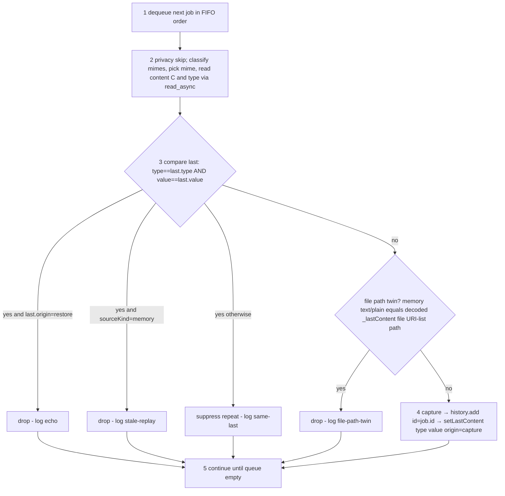

# Clipboard capture - restore, enqueue, drain

> Target design for the capture pipeline (monitor + extension). Producer/consumer split: the
> `owner-changed` handler (**enqueue side**) is trivial - it only snapshots the
> synchronously-available fields and pushes a job; the **drain side** does all the work
> (read content, compare-with-last, drop/capture). Agreed model: single `_lastContent`,
> **no TTL**, drop decided by consecutive content match (same `type` + same `value`),
> no history lookup, no hash, no enqueue-time marking, no grace window; a uuid `id` is threaded through the whole
> lifecycle. File-copy capture/restore policy is documented separately in
> [file-twin-design](file-twin-design.md). Accepted tradeoffs are listed under
> [Known limitations](#known-limitations).


## Data model

### IDs

- **`id` (uuid)** - assigned by the enqueue side the moment an `owner-changed` is received.
  Globally unique. For a **captured** event it is reused as the history record's `id`
  (passed monitor → extension → `history.add`), so one uuid spans event → record → all logs.
  The unique identity to grep on.
- **`seq` (integer)** - a per-session ordinal for human-readable ordering in logs. Resets to
  1 on every extension restart, so it **repeats across restarts** - never an identity, only a
  within-session reading aid.

Per-job pipeline lines carry `id=<uuid> seq=<n>`. Loop/lifecycle lines (drain start/stop,
`setLastContent`, `restored`, monitor start/stop) carry `id` only or neither.


### `job` (one per owner-changed; built by the enqueue side)

```
job = { id, seq, source, sourceLabel, sourceKind, mimes }
       sourceKind: 'memory' | 'non-memory'   // memory = Shell-owned (our writes, screenshots, caches)
```

`sourceKind` + `mimes` are snapshotted **synchronously at receive** (the source may go stale
before the drain reaches it). Content (`value`) is **not** read here - that is async, done on
the drain side. No `staleReplayAfterSeq` - the drop decision needs no lookahead.


### `_lastContent` (single shared state, no TTL)

```
_lastContent = { id, origin, sourceKind, source, type, value }
```

| field        | meaning                                                  | set on restore                   | set on capture         |
|--------------|----------------------------------------------------------|----------------------------------|------------------------|
| `id`         | trace uuid                                               | a fresh uuid for this self-write | the producing `job.id` |
| `origin`     | how it was set - splits log reason (echo vs replay)      | `'restore'`                      | `'capture'`            |
| `type`       | content kind: `text` / `file` / `image` - **rule field** | the restored kind                | the captured kind      |
| `value`      | content - **rule field**                                 | the written content              | the captured content   |
| `sourceKind` | memory / non-memory (log only)                           | `'memory'`                       | `job.sourceKind`       |
| `source`     | source label (log only)                                  | `'(self-restore)'`               | `job.sourceLabel`      |

The drop rule reads only **`type` + `value`**. `origin` and the current job's `sourceKind`
split the log reason. `id`/`sourceKind`/`source` are context/logging.

**Why `type` + `value`:** only the immediately previous clipboard payload is compared.
This catches restore echoes, stale memory replays, and Wayland/clipboard-manager owner
re-announces without restoring old history-wide dedup. `type` guards against a text and a
file/image sharing a string. Accepted tradeoff: consecutive identical user copies collapse
to one visible entry.


## Logging levels

Per-job pipeline lines carry `id=<uuid> seq=<n>` so one event can be grepped end to end
(lifecycle/state lines may carry only `id` or neither - see Data model > IDs). Level
convention across all four flows:

- **debug** - every routine step (the normal path). Enqueue: received, job built, pushed.
  Drain: dequeued, source read, compare result, **drop reason** (`echo` / `stale-replay` / `same-last`),
  capture, `setLastContent`. File restore: target app class and selected restore mode.
  Restore: backup/set/touch steps. Also benign skips (concealed selection, empty content).
- **info** - a notch above routine: user-meaningful milestones at default level, e.g.
  `restored id=...  kind=...  bytes=... `, history loaded (`N entries`).
- **warn** - recoverable anomalies that skip work but never crash/hang the shell: clipboard
  or source read timeout/failure, oversized item skipped (exceeds payload cap), restore
  write failed/aborted, file read skipped, suppressed-repeat top mismatch.
- **error** - serious but still fail-closed: image capture disabled for the session after
  repeated read failures; config parse failure.


---

## Flow 1 - Restore (write-back)



1. Check whether the selected record was row 1 in the sorted history and its `usedAt` is
   inside `ui.skipClipboardWriteForRecentTopSec` (`0` disables).
2. If the recent row-1 shortcut applies, skip only the system clipboard write.
3. Otherwise **backup** the current `_lastContent`, **setLastContent** with
   `origin='restore'`, `type=`restored kind, `value=`written content, fresh `id`,
   `sourceKind='memory'`, `source='(self-restore)'`, then write the real system clipboard
   (`setText` / `setContent`).
4. On **write success** or **write skip**, `history.touch(rec)` - MRU front in memory,
   async persist. We do **not** wait for the echo, so the UI never flickers.
5. On **write failure**, `setLastContentIfIs(backup)` - roll back if `_lastContent` is still
   the restore marker.
6. If `ui.autoPaste`, schedule the paste keystroke.

When a write happened, the echo arrives later as a memory event with the same `type`+`value`
and is dropped on the drain side. Restore itself enqueues nothing.


## Flow 2 - Enqueue (producer; `owner-changed` handler)



1. **Receive** `owner-changed`.
2. **Guard:** ignore if stopped, not the CLIPBOARD selection, or the source is null
   (selection cleared) → return.
3. **Build job:** assign `id` (uuid) and `seq`; snapshot `sourceKind` (from the source label)
   and `mimes` (`get_mimetypes()`) **synchronously** - the source may go stale before the
   drain reaches it. No content read here.
4. **Push** the job onto the FIFO queue.
5. If the drain loop is idle, **start** it. The handler returns immediately; all real work is
   on the drain side.


## Flow 3 - Drain (consumer; the only place content is read and decided)



1. A single **drain** loop dequeues jobs in arrival (FIFO) order - reads never overlap.
2. **Read** content: first skip concealed/secret selections (privacy, by `privacy.secretMimes`);
   then classify `job.mimes` (uri-list/x-special → file, image/png → image, text/plain → text),
   pick the mime, and read `C` + its `type` from `job.source` via `read_async` (tied to *this*
   event's source, not the live clipboard). If the chosen text reads back empty, fall through
   to the image branch.
3. **Compare with `_lastContent`** - the drop test:
   `type == _last.type` **and** `value == _last.value`.
   - true and `_last.origin == 'restore'` → **drop**, log `echo` (our write-back coming back).
   - true and `job.sourceKind == 'memory'` → **drop**, log `stale-replay`.
   - true otherwise → **suppress repeat**, log `same-last` (consecutive same content /
     owner re-announce) and notify extension-side bookkeeping.
   - false → check file path twin, then capture if it is not a twin.
4. **File path twin check:** if `job.sourceKind == 'memory'`, the current payload is
   `text/plain`, `_lastContent.type == 'file'`, and the text exactly equals the decoded path
   text for `_lastContent.value` (the current file URI-list), **drop**, log
   `file-path-twin`. This catches stale memory path twins without blocking unrelated memory
   text copies.
5. **Capture:** `history.add` using `job.id` as the record id, then
   `setLastContent({ type, value, origin:'capture', sourceKind:job.sourceKind, source, id:job.id })`.
   For suppressed repeats, extension bookkeeping verifies the current top history record has
   the same kind and payload, then `history.touch(top)` updates `usedAt` and queues the
   normal async snapshot. If top does not match, it warns and skips the touch.
6. Loop until the queue is empty. Each compare runs against the state the *previous* processed
   job left, so it is consistent with FIFO order - but note a capture can overwrite a pending
   restore marker (see [Known limitations](#known-limitations)).


### Truth table

| current sourceKind | type+value == last | last.origin | result                                                                        |
|--------------------|--------------------|-------------|-------------------------------------------------------------------------------|
| any                | no                 | *           | capture if not a file-path-twin                                               |
| any                | yes                | restore     | **drop** (echo)                                                               |
| memory             | yes                | capture     | **drop** (stale replay)                                                       |
| non-memory         | yes                | capture     | **drop** (same-last)                                                          |
| memory text/plain  | no                 | *           | **drop** only when `_lastContent.type=file` and text equals decoded file path |

## File copies

File-copy handling is intentionally simple: capture one `kind=file` record from
`text/uri-list`; restore later chooses GNOME's file-copy MIME or decoded path text by
target app.
Keep that policy out of the generic queue/drop model; see
[file-twin-design](file-twin-design.md).


## Known limitations

Accepted tradeoffs of the single-`_lastContent`, content-match model. All are bounded and
fail-closed (a wrong call yields at most a duplicate or a missed drop - never a crash/hang).

- **Self-write marker churn.** `_lastContent` is one shared slot. If a real (non-memory) copy
  is captured *between* a restore's `setLastContent(origin='restore')` and that restore's echo
  reaching the drain, the marker is overwritten and the echo is captured as a **duplicate** of
  the restored entry. Needs a copy to interleave a restore (narrow window); it is the
  deliberate cost of one slot instead of a separate self-write field.
- **Consecutive same content collapses.** Copying the exact same payload twice in a row
  produces one visible entry; the top entry's `usedAt` is refreshed if it still matches the
  dropped payload. This is intentional for stability on Wayland owner re-announce paths, and
  is still not old dedup because older matching history records are never searched or
  promoted.
- **Replay of older-than-last content.** Only the most-recent content is remembered, so a
  replay of content *older* than the last capture (`copy aaa → copy bbb → replay aaa`) is not
  recognised and is captured. Rare.
- **Read-before-drop cost.** An echo/replay is fully read (async, bounded by caps + 2 s
  timeout) before being dropped, and `_lastContent.value` holds the last content (for images,
  base64 up to the cap) until the next event - bounded and overwritten, not a leak.
- **Screenshot capture rides the image path.** Capturing screenshots / memory images depends
  on `general.captureImages`, which `WARNING.md` flags as the risky GI path (prior `signal 11`
  on Shell 46). Disable it there if the session destabilises.
