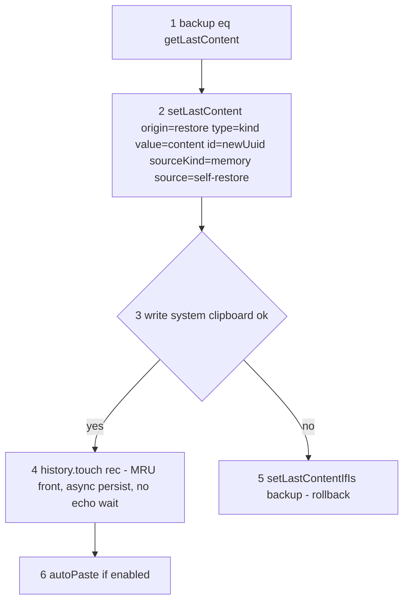
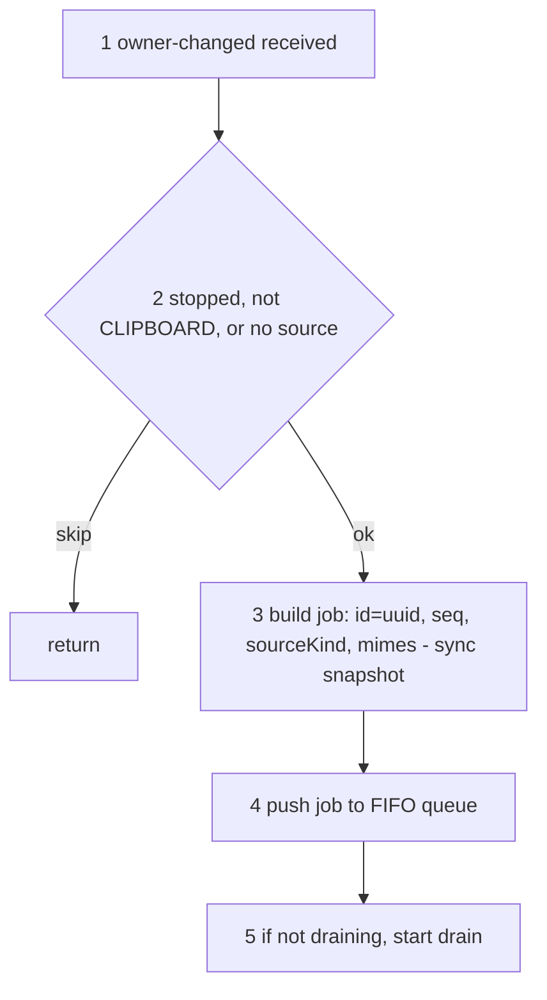
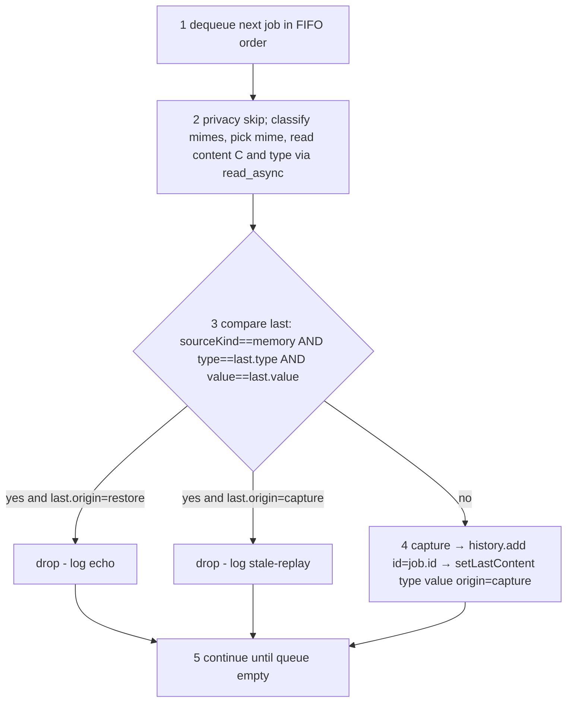
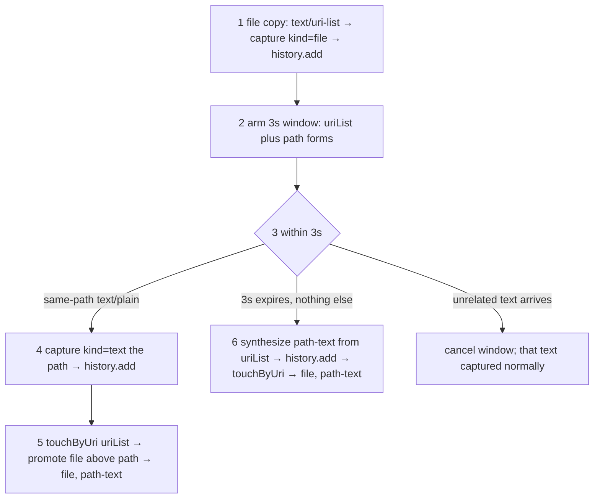

# Clipboard capture - restore, enqueue, drain, file twin

> Target design for the capture pipeline (monitor + extension). Producer/consumer split: the
> `owner-changed` handler (**enqueue side**) is trivial - it only snapshots the
> synchronously-available fields and pushes a job; the **drain side** does all the work
> (read content, compare-with-last, drop/capture). Agreed model: single `_lastContent`,
> **no TTL**, drop decided by content match (memory source + same `type` + same `value`),
> no enqueue-time marking, no grace window; file-twin with synth-on-expiry; a uuid `id`
> threaded through the whole lifecycle. Accepted tradeoffs are listed under
> [Known limitations](#known-limitations).


## Data model

### IDs

- **`id` (uuid)** - assigned by the enqueue side the moment an `owner-changed` is received.
  Globally unique. For a **captured** event it is reused as the history record's `id`
  (passed monitor → extension → `history.add`), so one uuid spans event → record → all logs.
  The unique identity to grep on.
- **`seq` (integer)** - a per-session ordinal for human-readable ordering in logs. Resets to
  1 on every extension restart, so it **repeats across restarts** - never an identity, only a
  within-session reading aid.

Per-job pipeline lines carry `id=<uuid> seq=<n>`. Loop/lifecycle lines (drain start/stop,
`setLastContent`, `restored`, monitor start/stop) carry `id` only or neither.


### `job` (one per owner-changed; built by the enqueue side)

```
job = { id, seq, source, sourceLabel, sourceKind, mimes }
       sourceKind: 'memory' | 'non-memory'   // memory = Shell-owned (our writes, screenshots, caches)
```

`sourceKind` + `mimes` are snapshotted **synchronously at receive** (the source may go stale
before the drain reaches it). Content (`value`) is **not** read here - that is async, done on
the drain side. No `staleReplayAfterSeq` - the drop decision needs no lookahead.


### `_lastContent` (single shared state, no TTL)

```
_lastContent = { id, origin, sourceKind, source, type, value }
```

| field        | meaning                                                  | set on restore                   | set on capture         |
|--------------|----------------------------------------------------------|----------------------------------|------------------------|
| `id`         | trace uuid                                               | a fresh uuid for this self-write | the producing `job.id` |
| `origin`     | how it was set - splits log reason (echo vs replay)      | `'restore'`                      | `'capture'`            |
| `type`       | content kind: `text` / `file` / `image` - **rule field** | the restored kind                | the captured kind      |
| `value`      | content - **rule field**                                 | the written content              | the captured content   |
| `sourceKind` | memory / non-memory (log only)                           | `'memory'`                       | `job.sourceKind`       |
| `source`     | source label (log only)                                  | `'(self-restore)'`               | `job.sourceLabel`      |

The drop rule reads only **`type` + `value`** and the current job's `sourceKind`; `origin`
splits the log reason. `id`/`sourceKind`/`source` are context/logging.

**Why `type` + `value`:** a memory event is dropped only when its content matches what we
last wrote/captured - recognising our restore echo and stale memory replays - while a
genuinely **new** memory event (a screenshot, or any future memory content) has different
content and is **captured**. `type` guards against a text and a file/image sharing a string.
This is **not** dedup: it is scoped to `sourceKind == memory`; manual repeated copies are
`non-memory` and never suppressed.


## Logging levels

Per-job pipeline lines carry `id=<uuid> seq=<n>` so one event can be grepped end to end
(lifecycle/state lines may carry only `id` or neither - see Data model > IDs). Level
convention across all four flows:

- **debug** - every routine step (the normal path). Enqueue: received, job built, pushed.
  Drain: dequeued, source read, compare result, **drop reason** (`echo` / `stale-replay`),
  capture, `setLastContent`. File twin: window armed, twin hit, window expired + synth,
  window cancelled. Restore: backup/set/touch steps. Also benign skips (concealed selection,
  empty content).
- **info** - a notch above routine: user-meaningful milestones at default level, e.g.
  `restored id=...  kind=...  bytes=... `, history loaded (`N entries`).
- **warn** - recoverable anomalies that skip work but never crash/hang the shell: clipboard
  or source read timeout/failure, oversized item skipped (exceeds payload cap), restore
  write failed/aborted, file read skipped, twin promote target not found.
- **error** - serious but still fail-closed: image capture disabled for the session after
  repeated read failures; config parse failure.


---

## Flow 1 - Restore (write-back)



1. **backup** the current `_lastContent` so a failed write can be rolled back.
2. **setLastContent** with `origin='restore'`, `type=`restored kind, `value=`written content,
   fresh `id`, `sourceKind='memory'`, `source='(self-restore)'`. No timer.
3. **Write** the real system clipboard (`setText` / `setContent`).
4. On **success**, `history.touch(rec)` - MRU front in memory, async persist. We do **not**
   wait for the echo, so the UI never flickers.
5. On **failure**, `setLastContentIfIs(backup)` - roll back if `_lastContent` is still the
   restore marker.
6. If `ui.autoPaste`, schedule the paste keystroke.

The echo arrives later as a memory event with the same `type`+`value` and is dropped on the
drain side. Restore itself enqueues nothing.


## Flow 2 - Enqueue (producer; `owner-changed` handler)



1. **Receive** `owner-changed`.
2. **Guard:** ignore if stopped, not the CLIPBOARD selection, or the source is null
   (selection cleared) → return.
3. **Build job:** assign `id` (uuid) and `seq`; snapshot `sourceKind` (from the source label)
   and `mimes` (`get_mimetypes()`) **synchronously** - the source may go stale before the
   drain reaches it. No content read here.
4. **Push** the job onto the FIFO queue.
5. If the drain loop is idle, **start** it. The handler returns immediately; all real work is
   on the drain side.


## Flow 3 - Drain (consumer; the only place content is read and decided)



1. A single **drain** loop dequeues jobs in arrival (FIFO) order - reads never overlap.
2. **Read** content: first skip concealed/secret selections (privacy, by `privacy.secretMimes`);
   then classify `job.mimes` (uri-list/x-special → file, image/png → image, text/plain → text),
   pick the mime, and read `C` + its `type` from `job.source` via `read_async` (tied to *this*
   event's source, not the live clipboard). If the chosen text reads back empty, fall through
   to the image branch.
3. **Compare with `_lastContent`** - the drop test:
   `job.sourceKind == 'memory'` **and** `type == _last.type` **and** `value == _last.value`.
   - true and `_last.origin == 'restore'` → **drop**, log `echo` (our write-back coming back).
   - true and `_last.origin == 'capture'` → **drop**, log `stale-replay` (a memory replay of
     content we already hold; scoped to memory, so not dedup).
   - false → **capture**.
4. **Capture:** `history.add` using `job.id` as the record id, then
   `setLastContent({ type, value, origin:'capture', sourceKind:job.sourceKind, source, id:job.id })`.
5. Loop until the queue is empty. Each compare runs against the state the *previous* processed
   job left, so it is consistent with FIFO order - but note a capture can overwrite a pending
   restore marker (see [Known limitations](#known-limitations)).


### Truth table

| current sourceKind | type+value == last | last.origin | result                                             |
|--------------------|--------------------|-------------|----------------------------------------------------|
| non-memory         | *                  | *           | capture (real copy; manual repeats not deduped)    |
| memory             | no                 | *           | **capture** (new memory content - e.g. screenshot) |
| memory             | yes                | restore     | **drop** (echo)                                    |
| memory             | yes                | capture     | **drop** (stale replay)                            |


## Flow 4 - File twin (file + its text/plain path)



1. A file copy arrives as `text/uri-list` (or `x-special/gnome-copied-files`) → capture a
   **`kind=file`** record.
2. Arm a **3 s window** (`_lastFile`) remembering the uri-list and every path form a later
   `text/plain` echo could use (each `file://` uri, each decoded bare path, the newline-join
   for multi-file).
3. Branch on what happens within 3 s.
4. If a **`text/plain`** event whose text matches one remembered path form arrives → it's the
   path twin; capture it as a **`kind=text`** record (so the bare path pastes into editors).
5. `touchByUri(uriList)` promotes the file record back **above** the just-added path →
   order `[file, path-text]`. History-only; no clipboard write.
6. If the **3 s expires** with no matching twin (and nothing else replaced the window) →
   **synthesize** the path-text from the uri-list and add it the same way → `[file, path-text]`.
   So the path entry exists even when the source app never offered `text/plain`. The synth is a
   **direct capture emitted outside the drain** (from the window timer) - it does not run the
   Flow 3 compare-last rule and does not update `_lastContent`.
   - If **unrelated text** arrives during the window, the window is cancelled and that text
     is captured normally; no path is synthesized.

> File capture reads/keeps only URI/path references, never file bytes.


## Known limitations

Accepted tradeoffs of the single-`_lastContent`, content-match model. All are bounded and
fail-closed (a wrong call yields at most a duplicate or a missed drop - never a crash/hang).

- **Self-write marker churn.** `_lastContent` is one shared slot. If a real (non-memory) copy
  is captured *between* a restore's `setLastContent(origin='restore')` and that restore's echo
  reaching the drain, the marker is overwritten and the echo is captured as a **duplicate** of
  the restored entry. Needs a copy to interleave a restore (narrow window); it is the
  deliberate cost of one slot instead of a separate self-write field.
- **Replay of older-than-last content.** Only the most-recent content is remembered, so a
  memory replay of content *older* than the last capture (`copy aaa → copy bbb → memory replay
  of aaa`) is not recognised and is captured. Rare.
- **Memory-source assumption.** Drops require the echo to arrive as `sourceKind == memory`,
  assuming our own write-back always surfaces as a memory source. Re-verify on GNOME 50 -
  `MetaSelection` ownership behavior is flagged as likely to drift (see `WARNING.md`).
- **Read-before-drop cost.** An echo/replay is fully read (async, bounded by caps + 2 s
  timeout) before being dropped, and `_lastContent.value` holds the last content (for images,
  base64 up to the cap) until the next event - bounded and overwritten, not a leak.
- **Screenshot capture rides the image path.** Capturing screenshots / memory images depends
  on `general.captureImages`, which `WARNING.md` flags as the risky GI path (prior `signal 11`
  on Shell 46). Disable it there if the session destabilises.
